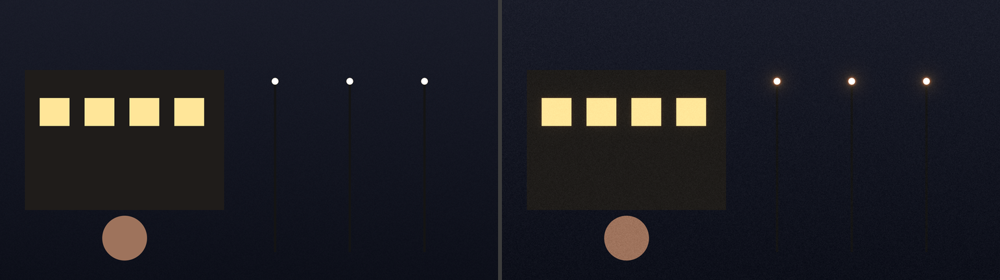

# Film Effects (Premiere Pro)

Native Premiere Pro video effects with three film-finishing tools — **Bloom**, **Halation** and
**Film Grain** — made to sit after Lumetri Color on a clip, or on an adjustment layer above your
graded timeline.

Four effects are installed under **Venosta Visuals**:
- **Film Effects** — all three tools in one effect, each with its own on/off switch, plus presets
- **Film Bloom**, **Film Halation**, **Film Grain** — each tool on its own, when you only need one

They share the same processing code, so Film Grain looks exactly like Film Effects with only
Grain switched on.

> **Status: first Mac release — user-tested in Premiere Pro 27 on Apple Silicon.**
> All four effects appear in Premiere and the user reports satisfactory operation. CPU tests on
> Linux/macOS/Windows and the Metal GPU comparison pass in CI. Export matching, long timeline
> stability, HDR workflows, performance measurements and Windows host operation remain unverified.
> Free and provided without warranty — see the [root README](../../README.md#️-no-guarantee).

Downloads will also be available at [venostavisuals.com](https://venostavisuals.com).

### DaVinci Resolve (OpenFX) — experimental

The same four effects are also built as an **OpenFX plug-in for DaVinci Resolve** (Windows,
macOS, Linux), with the same parameters, presets and rendering code. Releases include
`FilmEffects-Resolve-Windows-Setup-<version>.exe`, `FilmEffects-Resolve-mac-<version>.pkg` and
`FilmEffects-Resolve-linux-<version>.tar.gz`. After installing, restart Resolve. The effects are in
the **Effects** library under **OpenFX → Venosta Visuals**.
GPU: **Metal** on macOS and **NVIDIA CUDA** on Windows (GTX 1080 and newer; needs the NVIDIA
driver, not the CUDA Toolkit), CPU otherwise and on Linux. One download per system contains both
paths; Resolve uses CUDA when Preferences → Memory and GPU → GPU processing mode is CUDA, and
the CPU otherwise. Status: built and loaded like an OFX
host in CI; the GPU maths in Resolve's frame layout is checked against the CPU reference.
**User-tested in DaVinci Resolve on macOS** (v1.0.9); Windows and Linux not yet tested in Resolve.
The installers are not code-signed (a free hobby project, deliberately without paid signing
certificates; the full source is public): allow them in System Settings → Privacy & Security
(Mac) or confirm the Windows warning ("Install anyway"). Install locations:
`C:\Program Files\Common Files\OFX\Plugins`, `/Library/OFX/Plugins`, `/usr/OFX/Plugins`.


<sub>CPU reference render of a synthetic test scene ("Subtle Film" preset) — not a Premiere screenshot.</sub>

## What it does

| Tool | What you get | Main controls |
| --- | --- | --- |
| **Bloom** | Soft, multi-scale glow from highlights that keeps each light's colour | Intensity, Threshold, Soft Knee, Radius (% of frame height) |
| **Halation** | Warm red/orange fringe just outside bright edges (windows, lamps, neon) — not a red wash | Intensity, Threshold, Radius, Warmth |
| **Film Grain** | Organic, clumped grain that follows the image's tones, changes every frame and is identical every time you render the same frame | Amount, Size, Roughness, Shadow/Midtone/Highlight response, Luma/Color, Seed, Animate |

Global: Master Enable, Global Mix, Working Space (Rec.709 gamma 2.4 / sRGB / Linear), Processing
Quality. Presets: *Subtle Film, Soft Highlight Glow, Night Lights, Fine 35mm Grain, Coarse 16mm
Grain, Halation Only, Off* — choosing one fills in the normal parameters, which you can then tweak
and keyframe.

## Install

Download `FilmEffects-Premiere-mac-v*.pkg` from the repository's
[Releases page](https://github.com/d1anarene/venosta-visuals-plugins/releases).
Quit Premiere, double-click the `.pkg`, then restart Premiere. It installs Film Effects,
Film Bloom, Film Halation and Film Grain for Apple Silicon and Intel. Requires **macOS 26+**.
Existing bundles are backed up under `/Library/Application Support/Venosta Visuals/Backups/`.
The installer is unsigned, its bundles are ad hoc signed, and it is not Apple-notarized. If macOS
blocks it, use System Settings → Privacy & Security to review and allow this installer.

Film Effects is a native effect; its installer is `.pkg`, rather than a UXP `.ccx`.
Windows: download **`FilmEffects-Premiere-Windows-Setup-<version>.exe`** from Releases, double-click it,
confirm the admin prompt and restart Premiere. One build for every PC: it renders with NVIDIA CUDA
when the project uses Mercury Playback Engine GPU Acceleration (CUDA) and on the CPU otherwise.
Uninstall via Settings → Apps. The installer is not code-signed, so SmartScreen may warn
("More info" → "Run anyway"). The CUDA build uses CUDA 12.9 and includes Pascal (`sm_61`) code for GTX 1080,
plus targets for newer NVIDIA GPUs. It links the CUDA runtime statically: a compatible NVIDIA
driver is required, but the CUDA Toolkit is not. Windows Premiere behavior and NVIDIA GPU
execution remain unverified until hardware testing.
Build, installation and removal details: [docs/INSTALLATION.md](docs/INSTALLATION.md).
After installing and restarting Premiere: **Effects → Video Effects → Venosta Visuals**.

## Use

1. Grade your clips with Lumetri as usual.
2. Add an **Adjustment Layer** above the graded clips (or apply the effect after Lumetri on a clip).
3. Drag **Film Effects** onto it, pick a preset, then adjust Bloom / Halation / Grain
   (or use Film Bloom / Film Halation / Film Grain on their own).
4. Effects above it in the stack see the result; effects below it feed into it. On an adjustment
   layer it processes everything visible beneath it.

Tips: keep Working Space on *Rec.709 / Gamma 2.4* for normal SDR timelines; use *Linear* only if
your sequence works in linear light. Grain size is defined relative to a 1080-line frame, and the
bloom/halation radius relative to frame height, so the look stays the same in HD, 4K and in
reduced-resolution playback.

## How it works / docs

[ARCHITECTURE](docs/ARCHITECTURE.md) · [FEASIBILITY](docs/FEASIBILITY.md) ·
[IMAGE_QUALITY](docs/IMAGE_QUALITY.md) · [PERFORMANCE](docs/PERFORMANCE.md) ·
[LICENSING](docs/LICENSING.md) · [PROGRESS](PROGRESS.md)

## Develop

```bash
./scripts/run-core-tests.sh          # build + run the core tests (Linux/macOS/Windows)
./build/fe_render --scene night-street --preset "Night Lights" --before in.ppm --out out.ppm
./scripts/make-fixtures.sh           # all scenes x presets
```
