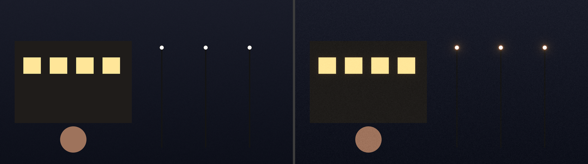
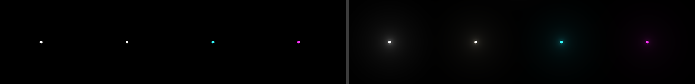
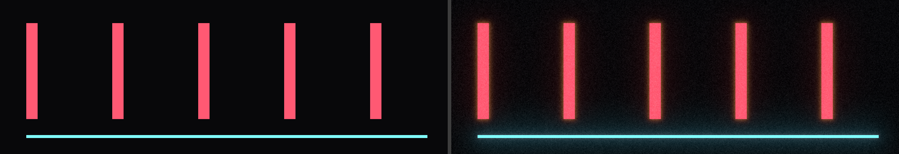
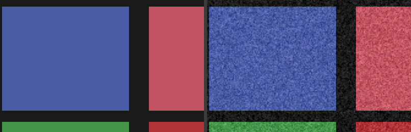

# Image quality

**All images below come from the development CLI (`tools/fe_render`) running the CPU reference on
synthetic scenes. None of them are Premiere Pro output.** They show the algorithms, not host
integration. Left = input, right = output. Regenerate with `scripts/make-fixtures.sh`.

## Night street — preset "Subtle Film" (scaled to 40 %)

Restrained: windows and lamps get a little glow and a warm rim, the skin-tone disc and the dark
building are unchanged except for grain.

## Halation around a bright window — "Halation Only" (100 %)

Warm fringe just outside the bright edges, fading within a few pixels; no red wash inside the
window and none in the dark surroundings away from the edge.

## Point lights (white, warm white, cyan, magenta) — "Soft Highlight Glow" (60 %)

Bloom keeps each light's own colour, has a bright core and a long soft skirt (multiscale), and is
symmetric. The 2-px hot spot at the top is kept small.

## Neon tubes and a thin bright line — "Night Lights" (50 %)

Red tubes get orange halation, the cyan line gets only bloom (halation is driven by red-layer
light), the thin line does not flicker into blocks.

## Grain at 100 % — "Fine 35mm Grain" and "Coarse 16mm Grain" (colour mode)

Irregular, clumped structure, no visible tile or grid; strongest in mid-tones, weaker on the near
black surround.

## Measured properties (automated, `tests/core`)

| Property | Test |
| --- | --- |
| Bypass is bit-exact (master off, mix 0, all off) | `bypass_*` |
| Below-threshold image untouched by bloom/halation | `below_threshold_image_unchanged_by_bloom_and_halation` |
| Bloom symmetric, falls off, multiscale skirt, neutral for white, no border, resolution-independent | `bloom_*` |
| Halation red-dominant, warm (G ≥ B), concentrated at edges, no global shift; cyan < white, magenta > cyan | `halation_*` |
| Grain deterministic, order-independent, per-frame change with similar statistics, seed, static when Animate off | `grain_*` |
| Grain spatially correlated (0.2 < ρ < 0.95), no periodicity at 32/64/128/256 px, luminance response | `grain_*` |
| Alpha unchanged, transparent pixels untouched, NaN/Inf/negative/HDR safe, odd sizes, strides | various |

## Still to review in Premiere (needs a Mac)

A/B at 100 % on real 1080p/4K footage (portrait, foliage, night exteriors), motion review for grain
flicker, CPU vs GPU difference images. See `tests/premiere-manual/CHECKLIST.md`.
